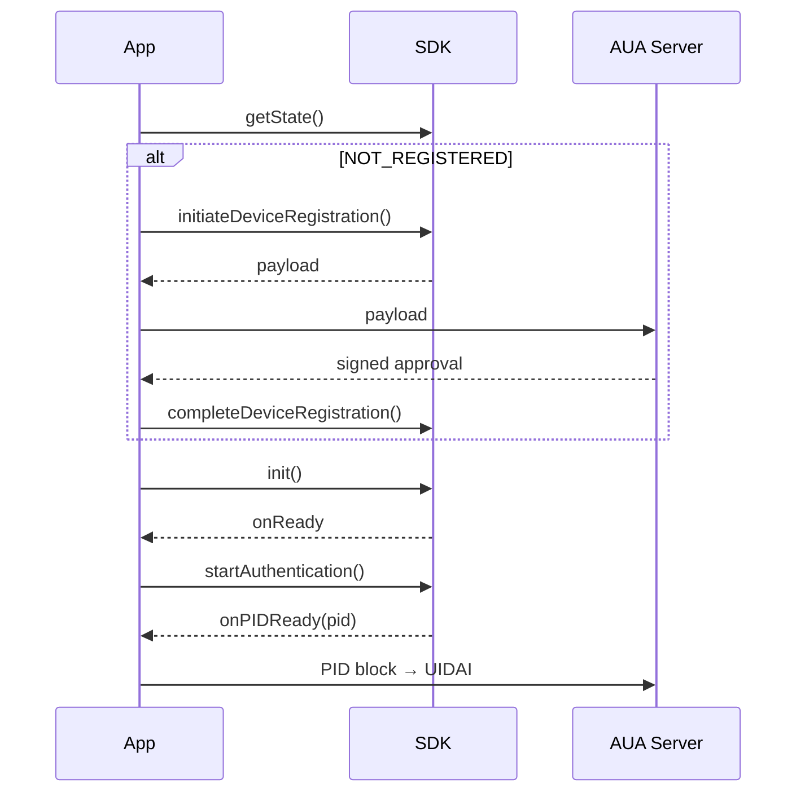

[← Home](README.md) · [1. Prerequisites](1-prerequisites.md) · [2. Audit checklist](2-audit-checklist.md) · **3. API guide** · [4. Error codes](4-error-codes.md)

# 3. API guide

Everything goes through **one object: `FaceAuthSDK`**. You will use **six functions**. That's it.

| # | Function | When | How often |
|---|---|---|---|
| 0 | `prefetchResources()` | App start (optional, makes things faster) | Every launch |
| 1 | `initiateDeviceRegistration()` | Phone is not registered yet | Once per phone |
| 2 | *(your server signs)* | — | Once per phone |
| 3 | `completeDeviceRegistration()` | After your server signs | Once per phone |
| 4 | `init()` | Before the first authentication | Every launch |
| 5 | `startAuthentication()` | User taps "Verify with face" | Every time |

---

## Step 0 — Choose your environment

```kotlin
val config = FaceAuthConfig.Builder()
    .setEnvironment(Environment.STAGING)   // STAGING · PRE_PROD · PROD
    .build()
```

> Default is `STAGING`. **Remember to switch to `PROD` for your release build.**

Optionally, start downloading the face model early (e.g. in `Application.onCreate()`), so `init()` is quicker later:

```kotlin
FaceAuthSDK.prefetchResources(context)
```

---

## Step 1 — Register the phone (first time only)

```kotlin
if (FaceAuthSDK.getState(this) == SDKState.NOT_REGISTERED) {

    FaceAuthSDK.initiateDeviceRegistration(this, auaCode = "YOUR_AUA_CODE", config) { result ->
        when (result) {
            is SDKResult.Success -> {
                val payload = result.data as RegistrationRequestPayload
                sendToMyServer(payload)          // → Step 2
            }
            is SDKResult.Error -> showError(result.code, result.message)
        }
    }
}
```

`getState()` returns:

| Value | Meaning |
|---|---|
| `NOT_REGISTERED` | Do Steps 1–3 |
| `READY_FOR_FACE_AUTH` | Skip to Step 4 |

---

## Step 2 — Get it signed by your server

Send the `payload` to your server as JSON. Your server:

1. **Checks** the device signature (`payload.signature`) using the device public key in `payload.registrationBlock.keyInfo.mc`.
2. **Builds** an `approval` object from `payload.registrationBlock` (same fields: `id`, `ts`, `device`, `keyInfo`, `appCertHash`, `uidaiNonce`).
3. **Signs** the approval JSON with your AUA private key (`SHA256withRSA`).
4. **Returns** this JSON string to the app:

```json
{
  "ver": "1.0",
  "txn": "<payload.txnId>",
  "approval": { ...approval object... },
  "signature": {
    "signedRef": "<approval.id>",
    "algo": "RS256",
    "hash": { "algo": "SHA-256", "value": "<base64 SHA-256 of approval JSON>" },
    "value": "<base64 signature of approval JSON>"
  }
}
```

> The sample app's `signJson()` in `MainActivity.kt` shows this logic. **Move it to your server** — never ship the private key in the app.

---

## Step 3 — Finish registration

```kotlin
FaceAuthSDK.completeDeviceRegistration(this, signedJsonFromServer) { result ->
    when (result) {
        is SDKResult.Success -> initSdk()                     // → Step 4
        is SDKResult.Error   -> showError(result.code, result.message)
    }
}
```

The phone is now registered. You won't need Steps 1–3 again unless registration expires.

---

## Step 4 — Start the SDK (every app launch)

```kotlin
FaceAuthSDK.init(
    context  = applicationContext,
    packageId = BuildConfig.APPLICATION_ID,
    config   = config,
    onReady  = { /* enable your "Verify with face" button */ },
    onError  = { error, code, message -> showError(code, message) },
    progressCallback = null    // optional, see below
)
```

The first time, `init()` downloads the face model (a few MB). After that it's fast.

<details markdown="1">
<summary>Want to show a progress bar? (optional)</summary>

Pass an `InitializationProgressCallback`:

```kotlin
progressCallback = object : InitializationProgressCallback {
    override fun onDownloadProgress(percentComplete: Int) { /* update bar */ }
    override fun onStatus(message: String) { /* show text */ }
    override fun onDownloadStarted() {}
    override fun onDownloadCompleted() {}
    override fun onLibraryDownloadStarted(architecture: String) {}
    override fun onLibraryDownloadProgress(percentComplete: Int, architecture: String) {}
    override fun onLibraryDownloadCompleted(architecture: String) {}
}
```
</details>

---

## Step 5 — Authenticate the user

First, pick what you need. Two settings decide everything:

| I want to… | `generatePid` | `skipFaceMatching` | You get |
|---|---|---|---|
| **Get a PID for Aadhaar auth** (no photo to compare) | `true` | `true` | `onPIDReady` |
| **Check the face matches my photo**, and then get a PID | `true` | `false` | `onSuccess`, then `onPIDReady` |
| **Only check the face matches my photo** | `false` | `false` | `onSuccess` |

If the face doesn't match, you get `onFailure` with code **760** and no PID.

The two most common ones:

### Option A — Get a PID block for Aadhaar authentication *(most common)*

The SDK captures the face and gives you an encrypted PID block. You send it to UIDAI through your server.

```kotlin
val params = AuthParams(
    txnId = newUniqueTxnId(),     // REQUIRED, new every time
    uid = "<aadhaar number>",
    generatePid = true,
    skipFaceMatching = true,      // no reference photo needed
    language = "en"               // "en", "hi", ...
)
FaceAuthSDK.startAuthentication(activity, referenceImageBase64 = "", params, callback)
```

You will get the result in `onPIDReady()`.

### Option B — Match against a photo you already have

The SDK compares the live face with your reference photo, on the phone.

```kotlin
val params = AuthParams(
    txnId = newUniqueTxnId(),
    enableLivenessCheck = true,
    generatePid = false
)
FaceAuthSDK.startAuthentication(activity, referenceImageBase64 = photoBase64, params, callback)
```

If the faces match, you get `onSuccess()` (with `result.matchScore`). If they don't, you get `onFailure()` with code **760**.

### The callback

```kotlin
val callback = object : AuthenticationCallback {
    override fun onCaptureProgress(progress: CaptureProgress) { /* optional: show progress.message */ }
    override fun onSuccess(result: AuthResult.Success)       { /* face captured / matched */ }
    override fun onPIDReady(pidResult: PidResult)             { sendToServer(pidResult.xml) }   // Option A
    override fun onReady()                                    { /* Option B: capture done; call FaceAuthSDK.generatePidBlock() if you also want a PID */ }
    override fun onFailure(error: AuthError, errorCode: Int, message: String) { showError(errorCode, message) }
    override fun onCancelled()                                { /* user pressed back */ }
}
```

> Callbacks may arrive on a background thread. Wrap UI updates in `runOnUiThread { }`.

### ⚠️ Send the PID block exactly as you got it

The PID block is **locked** — encrypted so only UIDAI can open it, and signed by the phone's secure key.

- **Don't change it in any way** — no reformatting, pretty-printing, re-serialising or adding fields. Even one changed character breaks the signature, and UIDAI rejects it.
- **Send it right away.** It can be used **once** and **expires in about 5 minutes**.
- **Don't log it, cache it or save it** anywhere.

---

## `AuthParams` — the settings that matter

| Setting | Default | What it does |
|---|---|---|
| `txnId` | — | **Required.** Your unique ID for this attempt. |
| `uid` | `""` | Aadhaar number (for PID generation). |
| `generatePid` | `false` | `true` = build a PID block automatically after capture. |
| `skipFaceMatching` | `false` | `true` = don't compare with a reference photo. |
| `enableLivenessCheck` | `true` | Check it's a real live person. Keep it on. |
| `returnCapturedImage` | `false` | `true` = give you the captured photo in `result.capturedImageBase64`. |
| `language` | `"en"` | Language for on-screen instructions. |
| `pidOptions` | `null` | Advanced PID settings (`wadh`, `env`, `pidVer`, …). Leave `null` unless UIDAI told you otherwise. |

---

## When registration expires (error 410)

The certificate UIDAI gives the phone at registration is valid for **365 days**. After that, `startAuthentication` fails with **410**. Fix:

```kotlin
FaceAuthSDK.clearRegistration(context)
// then run Steps 1 → 3 again
```

---

## Full flow at a glance



---

Something went wrong? → **[Error codes](4-error-codes.md)**
