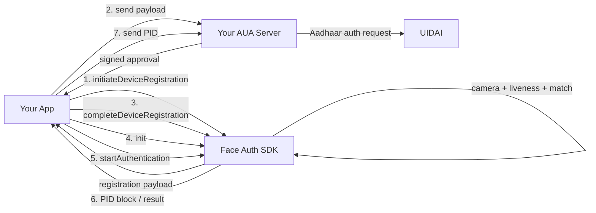

# Face Auth SDK — Integration Guide

> **In one line:** add this SDK to your Android app, and it will open the camera, check that a real person is in front of it, and give you a signed, encrypted result (PID block) that you send for Aadhaar face authentication.

You do **not** need to know face recognition, cryptography or camera code. The SDK does all of that. You only call a few functions.

---

## Pick your page

| Page | Read this if you want to know… | Time to read |
|---|---|---|
| [1. Before you start (AUA prerequisites)](1-prerequisites.md) | What you must have *before* writing any code | 3 min |
| [2. Audit checklist](2-audit-checklist.md) | What the SDK checks on the phone, and what *you* must take care of to pass audit | 4 min |
| [3. API guide](3-api-guide.md) | How to call the SDK, step by step, with copy-paste code | 8 min |
| [4. Error codes](4-error-codes.md) | What an error code means and what to do about it | look-up |

New here? Read them in order. Already integrating? Jump to page 3.

---

## The whole thing in one picture

**Steps 1–3 happen only once per phone** (registration).
**Step 4 happens once per app launch.**
**Steps 5–7 happen every time a user authenticates.**

---

## Words you will see

| Word | Simple meaning |
|---|---|
| **AUA** | You — the organisation that is allowed by UIDAI to do Aadhaar authentication. |
| **AUA code** | Your organisation's ID, given by UIDAI. |
| **Registration** | A one-time handshake that tells UIDAI "this phone + this app is trusted by this AUA". |
| **txnId** | A unique ID *you* create for every authentication attempt. Never reuse it. |
| **PID block** | The encrypted package with the captured face. Only UIDAI can open it. |
| **Liveness** | Check that a real live person is in front of the camera, not a photo or a screen. |
| **Reference image** | A known photo of the person, used when you want the SDK to match faces on the phone. |

---

## Need help?

When you contact support, always share: **the error code**, **the txnId**, **the environment** (STAGING / PRE_PROD / PROD) and **the phone model + Android version**.
